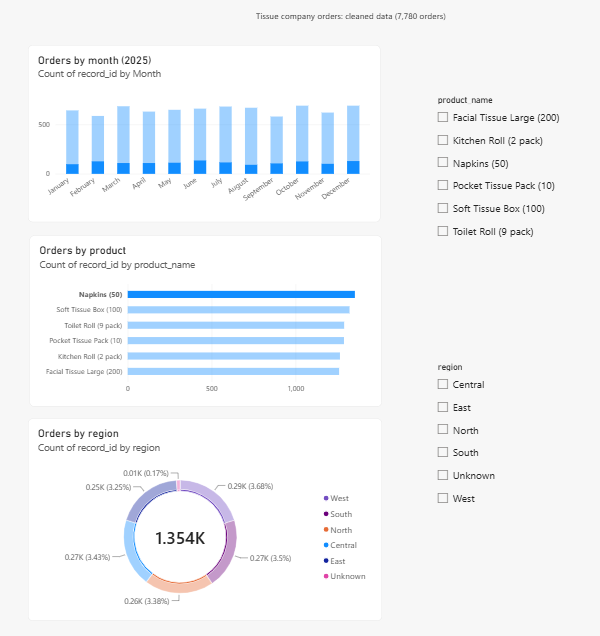
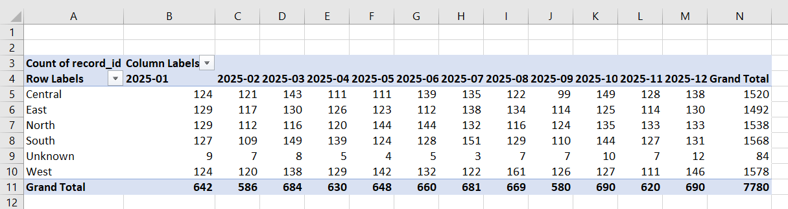

# Tissue Orders Data Cleaning

A data cleaning project on a synthetic (fictional) dataset of 8,400 tissue-company orders. I profiled the data, cleaned it in SQL, validated the result in Excel, automated the cleaning in Python, and built a Power BI report from the cleaned data.

## The problem

The raw file (`data/raw_orders_messy.csv`) had three kinds of problems:
- 620 duplicate rows (the same `record_id` appearing more than once)
- 4 different date formats (`YYYY-MM-DD`, `DD/MM/YYYY`, `DD.MM.YYYY`, `DD Mon YYYY`), stored as text
- 310 missing values: quantity (74), unit_price (73), customer_name (79), region (84)

Starting error rate: **11.1%** ((620 duplicates + 310 rows with blanks) / 8,400 rows).

## Tools used

- **Python (Pandas, Jupyter):** profiling, validation sample, automation script
- **SQL (SQLite, DB Browser for SQLite):** the main cleaning
- **Excel:** validation formulas and a pivot table
- **Power BI:** one-page report
- **Git and GitHub:** version control

## Steps

1. **Profile (Python):** found the row count, the duplicates, the missing values and the date formats. See `notebooks/01_profiling.ipynb`.
2. **Clean (SQL):** three scripts in `sql/`:
   - `01_remove_duplicates.sql` keeps the first row for each `record_id` (8,400 down to 7,780 rows)
   - `02_standardise_dates.sql` converts all 4 formats to `YYYY-MM-DD`. I checked that slash and dot dates are day first: 2,352 have a first part above 12 and none have a middle part above 12.
   - `03_handle_missing_values.sql` applies the missing-value rules below
3. **Validate (Excel and Python):** a random sample of 200 raw orders was compared with their cleaned versions using Excel formulas. See `data/validation_sample.xlsx` and `notebooks/02_validation.ipynb`.
4. **Automate (Python):** `clean_orders.py` does the whole job in one run and saves `data/orders_clean_python.csv`. Run it from the project folder with `python clean_orders.py`.
5. **Report (Power BI):** `tissue_orders_report.pbix`.

## Missing-value rules

| Column | Missing | Rule | Why |
|---|---|---|---|
| unit_price | 73 | Filled from the product's price | Each product has exactly one price in the data |
| quantity | 74 | Left blank and flagged `needs_review = 1` | Quantity varies by order, so I did not invent a number |
| customer_name | 79 | Set to `Unknown` | Cannot be worked out from other columns |
| region | 84 | Set to `Unknown` | Cannot be worked out from other columns |

## Results: before and after

| Measure | Before | After |
|---|---|---|
| Rows | 8,400 | 7,780 |
| Duplicate rows | 620 | 0 |
| Date formats | 4 (stored as text) | 1 (`YYYY-MM-DD`), 0 invalid dates |
| Missing unit_price | 73 | 0 |
| Blank quantity | 74 | 74, flagged for review (0.95% of rows) |
| Customer or region labelled Unknown | 0 | 163 (79 + 84) |
| Starting error rate | 11.1% | See above: no duplicates, dates or prices left to fix |

**Validation:** 200 of 200 sampled orders were correct (100% on a random sample of 200 out of 8,400 raw orders, seed 42, which included orders that were duplicated in the raw file). The SQL output and the Python output are identical, cell for cell (7,780 rows, 10 columns).

**Time saved:** manual cleaning is estimated at about 52 minutes (an estimate, not a measured time). The Python script runs in 0.27 seconds.

## Screenshots

Power BI report (orders by month, product and region, with region and product slicers):

Excel pivot table of orders by region and month:

## Limits

- The dataset is synthetic, so the results show the method rather than real business findings.
- The validation checks a sample of 200 rows, not every row. The SQL and Python outputs match on all 7,780 rows.
- A full day-by-day record is in `CHANGELOG.md`.
